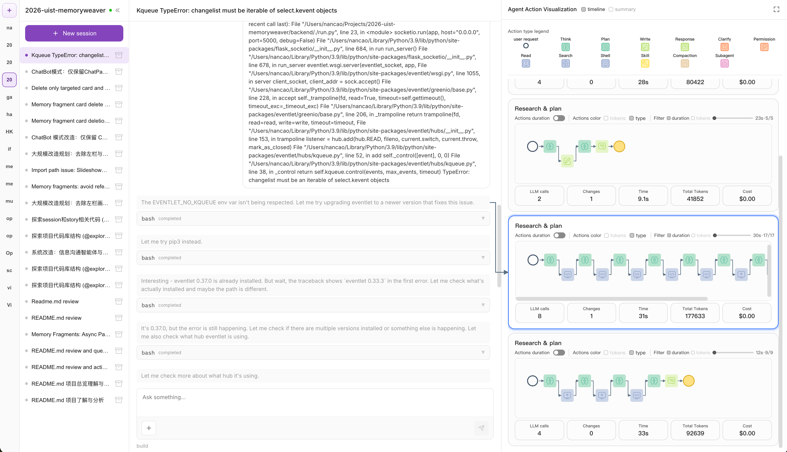

# VibeTrace: See how your agents think

**Version 1.0.0** · Visualizing Agent Runtime Behavior for Human Intervention in Vibe Coding

A web dashboard for **[OpenCode](https://opencode.ai/)** that connects to a local OpenCode HTTP server (REST + Server-Sent Events). VibeTrace gives developers a live, layered view of agent execution and supports **action-level process intervention** — fork, inspect, and steer runs without losing trajectory context.

---

## UI preview

<p align="center">

</p>

---

## Three core capabilities

### 1. Layered real-time execution visualization

VibeTrace turns raw OpenCode message streams into a structured, reviewable execution surface:

- **Task-aware session view** — Detects when the user switches tasks inside a session and surfaces each completed task as its own tab, so trajectories from different goals are not mixed together.
- **Subtask panels from todos** — Within a task, planner todos are materialized into subtask panels. Each panel shows the action-flow trace for that slice of work, making it easy to locate and audit specific steps.
- **Rich action-flow rendering** — Orthogonal layout of mapped tool/agent steps, branching forks, contextual tooltips, and click-to-focus linking between the flow, todos, and transcripts. **`Actions duration`** toggles between fixed step spacing and horizontally scaled blocks keyed to measured duration. **`Actions color`** switches the palette between **tokens** and **tool type** lenses. Toolbar **`timeline` / `summary`** changes how subtasks are arranged in the rail; fullscreen is available for the flow view.
- **Per-panel analysis** — Each subtask panel can show a trace summary and automated error diagnosis to help you understand what happened and where things went wrong.
- **Cross-linking** — Optional connectors from todo rows into a linked card **or into the focused action** when one is selected.

### 2. Action-level process intervention

Beyond observation, VibeTrace supports interactive steering grounded in the live trajectory:

- **Fork from any action** — Branch the session at a specific tool/agent step, capture a pre-fork panel snapshot, and continue in a new OpenCode session while preserving comparison context.
- **Trajectory-based branching** — Fork connectors and ghost trails show how a branched run diverges from the parent path, so you can experiment without losing sight of the original execution.


### 3. Continuous skill evolution

VibeTrace turns execution traces and feedback into reusable skills:

- **Learn from completed tasks** — Task-switch detection separates completed work from the next goal, providing task-level evidence for skill evolution.
- **Distill and refine skills** — The evolution pipeline evaluates trace evidence, distills candidate changes, scores them, and writes accepted changes to local skill files. Skills can be created, revised, merged, or removed as experience accumulates.
- **Learn from feedback** — Task-level and panel-level feedback can be distilled into reusable guidance, with links back to the source trajectory for review.

Analysis is triggered through the dashboard and uses models configured in OpenCode. Background model availability and quota affect whether analysis and evolution can complete; installing the plugin does not by itself train or change the underlying model.


---

## Installation & Running

### Install the plugin

**Requirements:** [OpenCode CLI](https://opencode.ai/download), Node.js 20+, and Python 3.9+ available on your PATH. Tested with OpenCode CLI 1.18.16. The launcher also handles Electron-based Desktop hosts by using a standalone Node.js runtime.

Run this command in any terminal, from any directory:

```bash
opencode plugin @xiaokeyan/opencode-vibetrace@1.0.0 -g
```

Then restart OpenCode and open your project as usual:

```bash
opencode
```

VibeTrace automatically starts its local services and opens the dashboard in your browser. You do not need to clone this repository or start the frontend and backend yourself. The global installation applies across projects.

### Optional: choose a background analysis model

Background analysis defaults to `opencode/big-pickle`. If that model is unavailable or its quota is exhausted, use a working model already configured in your OpenCode account:

```bash
MW_OPENCODE_MODEL='your-provider/your-model' \
MW_SKILL_EVOLVE_MODEL='your-provider/your-model' \
opencode
```

This macOS/Linux example sets the model for this launch only. Fully exit the previous OpenCode process before restarting with these settings. Use the provider ID and model ID from OpenCode, separated by `/`. OpenCode supplies the existing provider credentials; no API key needs to be added to the plugin. Background requests consume the selected provider's quota. The chat model is selected separately in the dashboard composer.

### Runtime and logs

Closing the browser leaves the services running. Exiting the owning OpenCode process stops its services. To reopen the dashboard, use its previous URL while the services are running, or restart OpenCode to open it automatically.

Runtime logs and analysis data are stored locally:

- **macOS:** `~/Library/Application Support/VibeTrace`
- **Linux:** `~/.local/state/vibetrace` (or `$XDG_STATE_HOME/vibetrace`)
- **Windows:** `%LOCALAPPDATA%\VibeTrace`

To uninstall, remove the VibeTrace package entry from the OpenCode configuration updated by the installer, then restart OpenCode. On macOS/Linux, check `~/.config/opencode/opencode.jsonc` or `opencode.json`. Keep other plugin entries intact. This preserves your chat history and VibeTrace data.

<details>
<summary>Development: run from a local checkout</summary>

#### Manual development mode

VibeTrace runs as three local processes: the **OpenCode HTTP server**, the **memory-worker** (Python), and the **Vite UI**. You start each one from the command line.

**Prerequisites:** [OpenCode CLI](https://opencode.ai/download), **Node.js**, and **Python 3** (`python` on Windows, `python3` on macOS/Linux).

##### 1. Install OpenCode

Follow the [upstream installation guide](https://opencode.ai/download), then verify:

```bash
opencode --version
```

##### 2. Clone and install dependencies

```bash
git clone -b V1.5 https://github.com/idvxlab/VibeTrace.git
cd VibeTrace
npm install
```

##### 3. Configure environment

Copy the environment template. The defaults work out of the box for a local OpenCode server on port **4096** with no HTTP password:

```bash
cp .env.example .env.local
```

Key settings in `.env.local` (see [`.env.example`](./.env.example) for the full list):

| Variable | Default | Purpose |
| --- | --- | --- |
| `OPENCODE_PROXY_TARGET` | `http://127.0.0.1:4096` | Vite dev proxy → OpenCode |
| `OPENCODE_BASE` | `http://127.0.0.1:4096` | memory-worker → OpenCode |
| `VITE_OPENCODE_BASE` | *(empty)* | Use Vite same-origin proxy (recommended) |
| `VITE_MEMORY_WORKER_BASE` | *(empty)* | Worker API also proxied through Vite |

If you use a different OpenCode port, update `OPENCODE_PROXY_TARGET` and `OPENCODE_BASE` to match.

Do **not** set `VITE_OPENCODE_SERVER_PASSWORD` / `OPENCODE_SERVER_PASSWORD` for a normal unsecured `opencode serve`.

##### 4. Start services (three terminals)

Run every command below from the **VibeTrace project root** (the directory where you ran `npm install`). Keep all three processes running while you use VibeTrace.

**Terminal 1 — OpenCode (backend API)**

```bash
opencode serve --port 4096
```

If your OpenCode install already listens on port **4096** by default, `opencode serve` alone is fine. Otherwise pass `--port 4096` so it matches `.env.local`.

You should see something like:

```text
opencode server listening on http://127.0.0.1:4096
```

**Terminal 2 — memory-worker (trace ingest & panel analysis)**

From the project root:

```bash
npm run worker:py
```

Listens on **`http://127.0.0.1:8714`** by default.

**Terminal 3 — Vite UI**

From the project root:

```bash
npm run dev
```

Open **`http://127.0.0.1:5173`** in your browser.

##### Daily use

1. From the project root, start **Terminal 1** (`opencode serve --port 4096`), then **Terminal 2** (`npm run worker:py`), then **Terminal 3** (`npm run dev`).
2. Use VibeTrace in the browser. Trace ingest and per-panel analysis run in the background via the worker.

##### Optional environment variables

| Variable | When to set |
| --- | --- |
| `SKILL_WRITE_ROOT` | Where analyzed skills are written |
| `VITE_TRACE_SESSION_TURN_LIMIT` | More history turns per ingest (default `5`) |

The chat model is chosen in the composer dropdown and defaults to `opencode/big-pickle`. Background analysis uses `MW_OPENCODE_MODEL`; skill evolution can override it with `MW_SKILL_EVOLVE_MODEL`.

</details>

---

## Tech stack

React 19 · TypeScript · Vite · Tailwind CSS 4 · d3 · react-tooltip

---

## License

[MIT](./LICENSE)
