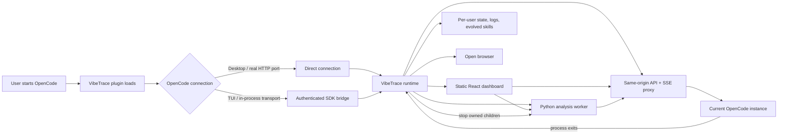

# VibeTrace plugin architecture

## Startup pipeline

1. OpenCode loads the npm plugin and supplies the current project, client, and server URL.
2. The plugin uses a real local server URL directly. If OpenCode is using its TUI-only in-process transport, the plugin exposes that transport through a private authenticated loopback bridge.
3. The launcher starts one runtime for that OpenCode process and connection.
4. The runtime chooses free loopback ports, starts the Python worker, serves the built React app, and opens the browser.
5. The runtime watches its parent OpenCode process and stops only the children it owns when that process exits.

## Request and analysis pipeline

1. The browser talks only to the VibeTrace same-origin runtime.
2. OpenCode REST and SSE requests are proxied to the exact OpenCode instance that loaded the plugin.
3. Analysis requests are proxied to the Python worker.
4. The worker reads trajectories through OpenCode, segments tasks, analyzes traces, and writes its derived state under the user's VibeTrace data directory.
5. The current product still triggers ingest and analysis from the open React page. Closing the page stops new browser-triggered analysis while OpenCode chat history remains available.
